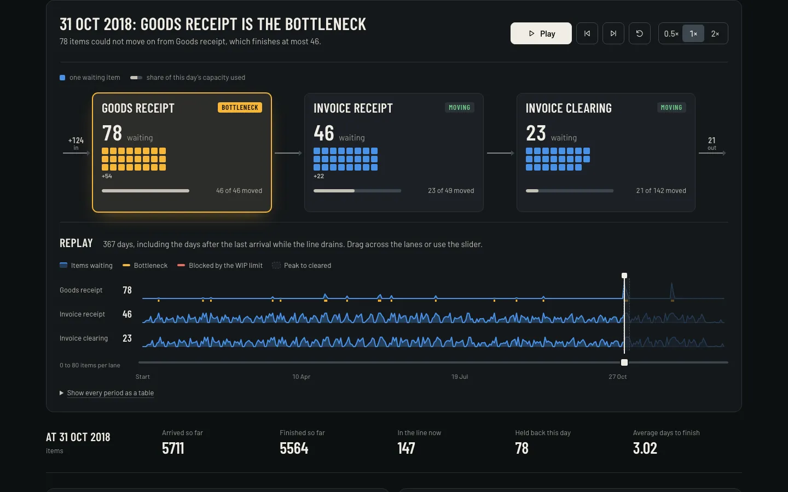

# queueglass

**Live demo: <https://queueglass.vercel.app>**



A seeded queue simulator. Work passes through four steps (Receive, Sort, Check, Finish). Pick a scenario and watch where it jams, then scrub back through every tick. All data is simulated in the browser.

## What it does

- **Three presets, one click each.** Steady traffic, a burst of extra arrivals at ticks 6 to 13, and a cascading failure where Check slows to one item per tick and the jam spreads upstream through full buffers.
- **A live board.** Items travel between the steps each tick. The step that left the most work unserved is marked as the bottleneck; steps held up by a full buffer after them are marked blocked.
- **A replay you can scrub.** The whole 60-tick run is computed up front, so the timeline shows every step's queue over time, with bottleneck and blocked ticks marked underneath. Drag across it, use the slider, or step with the arrow keys.
- **Settings you can change.** Raise or lower arrivals per tick and each step's capacity. The run recomputes from the same seed, and the share link carries the seed, scenario and settings.

## How it works

`src/lib/simulation.js` is a pure, seeded discrete-event model. Each tick it adds arrivals (base traffic plus 0 to 2 random, plus any burst), then serves the steps from Finish back to Receive. Serving downstream first means space freed later in the line is visible to the step feeding it on the same tick, and an item moves at most one step per tick. A step serves higher-priority items first, up to its capacity. In the cascade, buffers between steps hold six items, and a step facing a full buffer stops.

`runSimulation()` precomputes one frame per tick. The UI only indexes into those frames, so playback, scrubbing and the chart always agree.

```text
src/lib/simulation.js        seeded model, bottleneck rule, precomputed runs
src/components/SimulatorLab  page state, playback, URL and share link
src/components/FlowBoard     the four steps, moving items, capacity controls
src/components/Timeline      per-step queue lanes, scrubber, table view
tests/simulation.test.js     replay, conservation, buffer and bottleneck tests
scripts/browser-smoke.mjs    Chromium run of the main flows on desktop and phone
```

## Run locally

Node.js 24.

```bash
npm ci
npm run dev
```

Open <http://localhost:3000/?scenario=burst>.

## Tests

```bash
npm run verify        # claim and secret scans, lint, types, unit tests, build
npm run build && npm run start -- -p 4173
npm run test:browser  # in a second terminal
```

The browser smoke covers playback, stepping, keyboard control, scrubbing, presets, capacity edits, seed replay through a copied link, the 404 page, the phone layout and reduced motion.

## Limits of the demo

- Every number is generated by a small deterministic model. There is no real system, telemetry or benchmark behind it, and it should not be presented as evidence about one.
- Capacity is in items per tick and time is in ticks. The parameters are chosen to teach, not calibrated to anything.
- A run is 60 ticks long. Browser automation targets Chromium.

MIT licensed. See [CONTRIBUTING.md](CONTRIBUTING.md).
