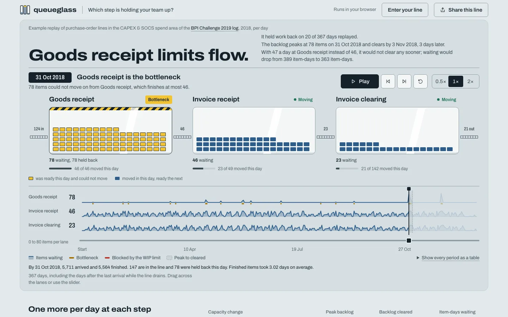

# queueglass

Queueglass replays a team's real arrivals through its workflow steps and names the step that limits flow. It then reruns the whole line with one more unit of capacity at each step, so you can see which change would clear a backlog sooner.



## Try it

Open <https://queueglass.vercel.app>. It starts on a worked example. For your own line, enter 2 to 8 steps with what each finishes per day or week, an optional WIP limit, and your arrivals as counts, dated counts (`2026-03-02,14`) or the Created column of a Jira, Linear or GitHub export. It all runs in the tab, and the share link keeps the line after the `#`, which browsers don't send to a server.

To run it locally on Node.js 24:

```bash
npm ci
npm run dev
```

`npm run verify` runs the secret scan, lint, types, unit tests and build. `npm run test:browser` drives a production build on port 4173 (`npm run build && npm run start -- -p 4173`) in Playwright.

## What's real

The example uses purchase-order lines from the CAPEX & SOCS spend area of the BPI Challenge 2019 event log, from a coatings and paints company. B. F. van Dongen (2019), 4TU.ResearchData, [doi:10.4121/uuid:d06aff4b-79f0-45e6-8ec8-e19730c248f1](https://doi.org/10.4121/uuid:d06aff4b-79f0-45e6-8ec8-e19730c248f1), licensed [CC BY 4.0](https://creativecommons.org/licenses/by/4.0/).

[`scripts/derive-bpi2019.mjs`](scripts/derive-bpi2019.mjs) checks the log against 4TU's published MD5 and counts, for each day of 2018, the lines created and the lines reaching each step for the first time. It writes [`data/bpi2019-capex-socs-daily.2026-10-23.csv`](data/bpi2019-capex-socs-daily.2026-10-23.csv), and you can rebuild that file by running the script on `BPI_Challenge_2019.xes` from the DOI. Each step's capacity is that activity's 90th-percentile daily count on the days it ran, which gives 46 goods receipts, 49 invoice receipts and 142 invoice clearings.

The replay is a model. [`src/lib/simulation.js`](src/lib/simulation.js) is a deterministic tandem queue. Each period's arrivals join the first step. Steps are then served in reverse order, oldest work ahead of newer, each up to its capacity, so an item moves at most one step per period. The bottleneck in a period is the unblocked step that left the most work waiting. Each +1 figure is a full rerun of the replay with that one capacity raised.

## Limits

Capacity is the same every period, weekends included. Every item passes every step, though 23% of the example's lines skip at least one step in the real log, so the example overstates the load on later steps. A line takes at least one period per step, and the cap is 1,000 periods and 8 steps.

Queueglass is MIT licensed, and [CONTRIBUTING.md](CONTRIBUTING.md) explains how to propose changes.
